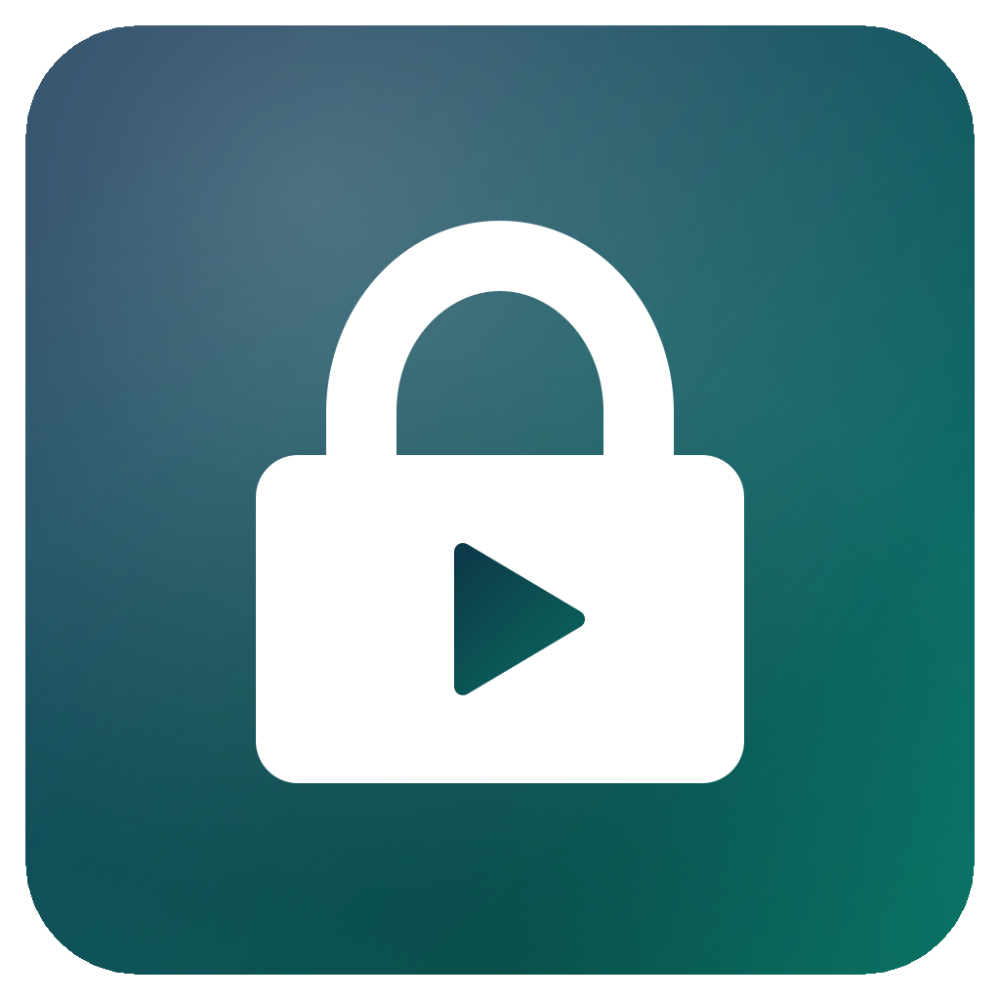

<p align="center">
  
</p>

<h1 align="center">VaultBox</h1>

<p align="center">加密图片与视频库：输入密码直接看，锁定后只剩密文。</p>

<p align="center">
  Java 17+ · macOS / Windows · 无第三方依赖
</p>

---

## 简介

VaultBox 把一个普通文件夹变成一个加密库。解锁后像普通文件列表一样浏览、看图和播放视频；点「锁定」后，磁盘上只留下加密后的乱码文件。

不是 VeraCrypt / Cryptomator 的兼容格式，也不会挂载虚拟磁盘——视频通过本机临时流服务按需解密，图片在内存中解码，不产生明文视频文件。

## 功能

- **整个文件夹加密**：一个文件夹就是一个库，可整体备份、拷贝到别的电脑
- **解锁即用**：密码解锁后直接浏览，不需要先手动解密
- **视频流式播放**：本地 `127.0.0.1` 服务 + HTTP Range，支持拖动进度，不把视频解密到硬盘
- **图片查看**：缩略图、应用内看图、左右键切换、触控板双指捏合缩放、拖动、双击 1:1、适应窗口
- **导入 / 导出 / 删除 / 搜索**，支持一次导入整个文件夹
- **播放器可配置**：macOS 默认 IINA，Windows 默认 VLC，也可手动填路径
- **锁定即保护**：擦除内存密钥、停止流服务、关闭看图窗口、覆盖并删除临时文件
- **跨平台**：同一套加密库在 macOS 和 Windows 上都能打开

## 环境要求

- JDK 17 或更新版本
- 视频播放建议安装 [IINA](https://iina.io/)（macOS）或 [VLC](https://www.videolan.org/)（Windows）

## 快速开始

### macOS

```bash
./build.sh
./run.sh
```

打包成可双击的 `.app`：

```bash
./make-app.sh
open VaultBox.app
```

### Windows

```bat
build.bat
run.bat
```

也可以直接运行：

```bash
java -jar VaultBox.jar
```

## 使用

1. 点「新建加密库」，选一个文件夹，设置至少 6 位的密码。
2. 点「导入文件」或「导入文件夹」，等待加密完成。**导入是复制加密，原文件不会被删除。**
3. 双击条目：
   - 图片：应用内查看，触控板捏合 / 滚轮缩放，拖动平移
   - 视频：调用 IINA / VLC 播放，可拖动进度
   - 其他文件：解密到临时目录后用系统应用打开
4. 用完点「锁定」。下次选择同一个文件夹，输入密码解锁。

> **密码无法找回。** 忘记密码等于数据永久丢失。
>
> 备份时请把 `vault.properties`、`index.enc`、`data/` 整个文件夹一起备份，缺一不可。

## 跨设备

加密库不绑定机器。把整个库文件夹拷到另一台电脑，装好 VaultBox、输入密码即可打开。

- macOS 用 `VaultBox.app`
- Windows 用 `build.bat` / `run.bat` 或 `java -jar VaultBox.jar`
- 视频能否播放取决于对方是否装了 IINA / VLC

## 加密设计

| 项目 | 方案 |
| --- | --- |
| 主密钥 | 32 字节随机数，仅存在于内存，锁定即擦除 |
| 口令派生 | PBKDF2-HMAC-SHA256，210,000 次迭代，16 字节随机盐 |
| 密钥包裹 | 口令密钥用 AES-256-GCM 包裹主密钥，存于 `vault.properties` |
| 文件内容 | 每个文件独立派生密钥，AES-256-GCM，64 KB 分块，每块独立 nonce / tag |
| 随机读取 | 分块密文支持按字节定位，视频拖动不必从头解密 |
| 索引 | 文件名、大小、修改时间整体加密为 `index.enc` |
| 密文命名 | `data/<UUID>.vfb`，不暴露原始文件名 |
| 本地服务 | 只绑定 `127.0.0.1`，URL 带进程内随机 token |

目录结构：

```
vault/
├── vault.properties   口令盐、迭代次数、被包裹的主密钥
├── index.enc          加密后的文件索引
└── data/
    └── <uuid>.vfb     每个文件的分块密文
```

## 安全边界

**能防：** 拿到加密库文件夹但没有密码的人；把库放进网盘或备份盘后的离线窥探。

**防不住：**

- 解锁状态下的截屏、录屏、内存抓取
- 系统级键盘记录器、恶意软件
- 高强度取证（本项目未做专项审计）
- 密码被猜到或泄露

**其它限制：**

- 锁定会中断正在播放的视频
- 删除条目会同时删除密文，无法恢复
- 导入时相同库内路径会覆盖旧文件
- 图片预览依赖 JDK 自带的 ImageIO，HEIC 等格式需用系统应用打开
- 单个密文文件损坏只影响该文件，但索引损坏会影响整个库（请整库备份）

## 项目结构

```
src/app/vault/
  Main.java           入口，支持 --selftest
  MainFrame.java      主窗口（解锁页 / 浏览页）
  UnlockPanel.java    解锁与新建加密库
  BrowserPanel.java   文件列表、导入、导出、删除、搜索
  ImageViewer.java    应用内看图、缩放与拖动
  Vault.java          加密库：创建、解锁、导入、读取、锁定
  EncryptedFile.java  分块 AES-GCM 文件格式与随机读取
  Manifest.java       加密索引的序列化
  StreamServer.java   本地 Range 流服务
  Player.java         外部播放器调用
  TempStore.java      临时文件（锁定时覆盖并删除）
  Crypto.java         PBKDF2 / AES-GCM / HMAC
  Thumbnails.java     后台缩略图
  Config.java         用户配置
  SelfTest.java       无界面自测
tools/IconGen.java    生成 icon.png / .icns / .ico
build.sh / build.bat  编译并打包 jar
run.sh / run.bat      启动
make-app.sh           生成 macOS .app
```

## 自测

```bash
./build.sh
java -cp out app.vault.SelfTest
```

覆盖 34 项检查：创建、错误密码、重新打开、加解密一致性、密文不含明文、随机读取、HTTP Range（含越界 416）、导出、删除、锁定状态。

## 配置

用户配置保存在：

- macOS / Linux：`~/.vaultbox/config.properties`
- Windows：`%USERPROFILE%\.vaultbox\config.properties`

包含上次打开的加密库路径和播放器路径。删除该文件即可重置。
